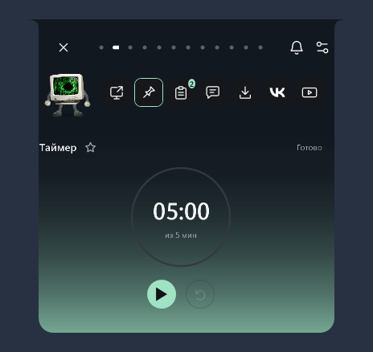
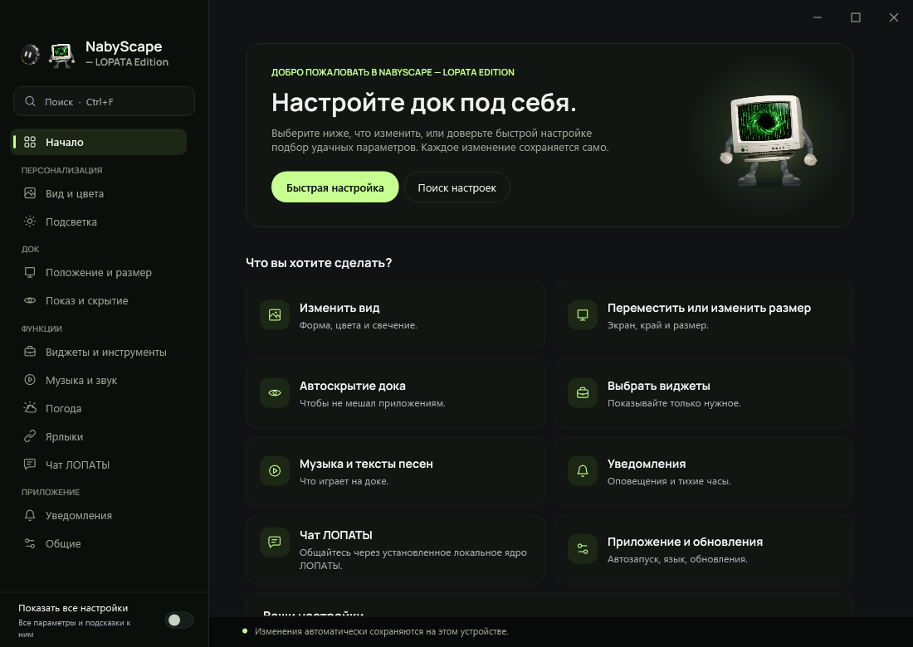

# NabyScape — LOPATA Edition

Настольный остров для [ЛОПАТЫ](https://github.com/PiTrolKun/LOPATA), локальной AI-мастерской для Windows. Держит под рукой музыку, задачи моделей, чат и виджеты. Остров работает отдельным процессом и может оставаться открытым после закрытия ЛОПАТЫ.

**[Скачать ЛОПАТУ для Windows x64](https://github.com/PiTrolKun/LOPATA/releases/download/installer/LOPATA_Setup.exe)** · [Выпуски ЛОПАТЫ](https://github.com/PiTrolKun/LOPATA/releases)

Код редакции опубликован. Пользовательская поставка острова начнётся с выпуска ЛОПАТЫ, который включает этот компонент. В таком выпуске утилита открывается через **Обработка / утилиты → Экран → NabyScape — LOPATA Edition (Остров)**.

## Возможности редакции

- **Музыка.** Остров играет треки из Коллекции ЛОПАТЫ и выбранных папок. Собирает избранное из разных источников и показывает текст песни с таймингами. Для музыки, созданной вне ЛОПАТЫ, доступен поиск текста. Поддержку внешних медиасессий Windows, включая YouTube в браузере, можно настроить.
- **Локальный чат.** Маскот и кнопка чата ведут в «Если накипело» с переносом черновика, когда ЛОПАТА открыта. При закрытой ЛОПАТЕ остров обращается к установленному локальному ядру.
- **Задачи и обновления.** Остров показывает состояние задач моделей и может проверять доступность обновлений ЛОПАТЫ, когда её окно закрыто.
- **Виджеты и оформление.** Таймер, системный монитор, погода, заметки, история буфера обмена и очистка ссылок. Звёздочка выбирает виджет, который открывается первым. Остров можно закрепить у любого края экрана. Боковая панель имеет вертикальную компоновку. Интерфейс использует локализацию ЛОПАТЫ, включая пользовательские переводы.

[Как пользоваться островом](docs/guide.md) · [Сетевые функции](docs/security.md) · [Локализация](docs/translating.md)

## Как выглядит

**Остров с таймером**

**Настройки**

## Сборка для разработчиков

Нужны Windows x64, PowerShell 7, .NET 10 SDK и две рабочие копии Git. Выберите ревизию [ЛОПАТЫ](https://github.com/PiTrolKun/LOPATA) с инструментом сборки острова, общим кодом Коллекции и обновлений. Эти инструменты пока доступны в локальной рабочей копии ЛОПАТЫ. В чистой рабочей копии форка выполните команду.

~~~powershell
./build.ps1 -LopataRepositoryRoot ../LOPATA -OutputDirectory ./artifacts-edition
~~~

Сценарий ЛОПАТЫ соберёт и проверит компонент в `artifacts-edition/NabyScape`. В этот каталог входят `LopataIsland.exe`, лицензии и манифест с контрольной суммой. Для повторной сборки укажите новый каталог. Параметр `-RunSelfTests` запускает расширенный набор проверок и сохраняет `unit-report.txt`.

Проверка пакета в GitHub Actions запускается вручную с указанием совместимого коммита или тега ЛОПАТЫ. Пользовательские обновления идут через выпуски ЛОПАТЫ. Теги редакции используют префикс `lopata-v` и соответствуют выпускам ЛОПАТЫ.

## Авторы и лицензии

Эта редакция основана на [NabyScape 2.27.0](https://github.com/BillyNabil/nabyscape/tree/v2.27.0). Спасибо BillyNabil и участникам проекта за исходный остров и его виджеты. [Оригинальный репозиторий](https://github.com/BillyNabil/nabyscape)

[Лицензия MIT оригинала](LICENSE) · [Лицензии зависимостей](licenses/) · [Лицензия GNU GPL 3.0 ЛОПАТЫ](https://github.com/PiTrolKun/LOPATA/blob/main/LICENSE)

## English summary

NabyScape — LOPATA Edition is the Windows desktop island packaged with [LOPATA](https://github.com/PiTrolKun/LOPATA), a local AI workbench. This official GitHub fork adds LOPATA's music collection, local chat, task and update status, mascot, and localization. The development build requires a compatible LOPATA checkout. For the original application, see [BillyNabil/nabyscape](https://github.com/BillyNabil/nabyscape).
